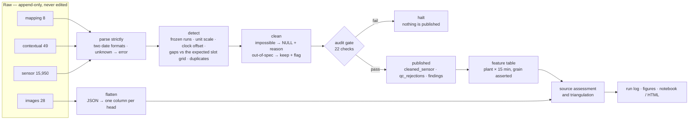

# FYTA — data quality assessment of an IoT soil-sensor fleet

Eight soil sensors, three weeks, 15,950 readings, 49 user notes and 28 plant
photos. The task was to find what is wrong with the data, clean a first pass a
modelling team could trust, and say plainly what could not be settled from it.

The work is one pipeline, one notebook, and a set of published tables. Every
number in the write-up comes out of `run.sh`.

---

## What the data is

Four tables in `data/`, delivered as-is and never edited:

| Table | Rows | Grain | What it holds |
|:---|---:|:---|:---|
| `fyta_sensor_sample.csv` | 15,950 | `device_id + timestamp` | five channels per reading, plus a substrate label |
| `fyta_contextual.csv` | 49 | `log_id` | user-entered notes: watering, fertilising, light, repotting |
| `fyta_images.csv` | 28 | `image_id` | a model's JSON prediction per photo |
| `user_plant_device_map.csv` | 8 | `device_id` | which sensor sits in which pot |

Two date formats coexist on purpose: seven devices write ISO, SENS-07 writes
day-first. `timestamp` keeps the source text; `ts_aligned` is the clock-corrected
datetime every join uses.

The sensor does not measure water. It measures dielectric permittivity and
converts it through a substrate-specific curve, so a VWC value is only comparable
within one substrate — that fact drives several of the findings.

---

## How it works



Three rules shape the middle of that diagram:

- **Raw is immutable.** Every fix lands in a `_clean` column beside the original,
  so the published table carries both, and a value that was emptied keeps its
  source value and its reason.
- **Two tiers, never one.** Physically impossible → `NULL` and recorded. Outside
  the published range but possible → kept and flagged. Collapsing the two is how
  real events get deleted.
- **Write, audit, publish.** The gate re-derives its checks from the raw frame
  rather than trusting the cleaner: every nulled value has a reason, every flag
  matches its detector, row accounting adds up, and a stripped flag or a deleted
  device fails the run instead of passing quietly.

---

## Run it

```bash
cd submission
uv run fyta_pipeline.py     # writes out/ and the full run log
uv run test_gates.py        # 20 regression checks
```

Or, from a copy of the folder that carries its own `data/` — nothing to install,
no environment to build by hand:

```bash
bash run.sh                 # Linux / macOS        (run.bat on Windows)
```

`run.sh` checks the data is in place, builds an environment (using `uv` when
present, otherwise a local `.venv`), runs the pipeline, the checks, and renders
the notebook to `FYTA_full_analysis.html`.

The notebook executes headlessly, which is how its stored outputs are kept
honest:

```bash
cd submission
uv run --with nbconvert python -m nbconvert --to notebook --execute \
  fyta_analysis.ipynb --output /tmp/nb.ipynb
```

The one-page submission note is `WRITEUP.md` → `WRITEUP.pdf`:

```bash
cd submission && uv run --with markdown python md_to_pdf.py
```

**Idempotent.** Same input, same output: a re-run reproduces every published
artifact byte-for-byte, `run.log` included. The four CSVs are resolved beside the
code or one level up, so the folder runs standalone or inside this repository.

---

## What it produces

`submission/out/` — all regenerable; delete it and re-run:

| File | Rows | What it is |
|:---|---:|:---|
| `cleaned_sensor.csv` | 15,935 | raw columns + `ts_aligned` + five `_clean` columns + `qc_nulled` (what was emptied, and why) + `qc_flags` (what was kept and marked) |
| `qc_rejections.csv` | 1,415 | every nulled value with its reason; whole rows appear only for duplicate quarantine |
| `plant_features.csv` | 11,903 | one row per plant per 15 minutes, grain asserted |
| `task2_findings.csv` | 13 | the findings, their class, severity and owner |
| `task2_coverage_gaps.csv` | 8 | slots due vs delivered, per device |
| `task2_detection_coverage.csv` | 13 | what caught each finding, and the check blind to it |
| `task4_source_assessment.csv` | 16 | the four sources, each metric run on the raw and the cleaned frame |
| `task6_triangulation.csv` | 5 | each fertilising event with all three legs |
| `task8_drydown.csv` | 15,935 | %VWC lost per day per reading, with an as-of timestamp |
| `task9_log_signals.csv` | 49 | the log text as structured fields |
| `images_flattened.csv` | 28 | the image table, one column per model head |
| `figures/*.png` | 2 | fleet overview, and moisture per device with the logs overlaid |
| `run.log` | — | the full run, every number in it computed rather than transcribed |

---

## Where each task lives

| Task | What it asks | Code | Notebook |
|:---|:---|:---|:---|
| **1** | Ingest & orient: what the data is | `fyta/sensors.py` | §1a–1e |
| **2** | Data quality: what is wrong with it | `fyta/sensors.py` | §2a–2c |
| **3** | Cleaning and normalization | `fyta/cleaning.py`, `fyta/sources.py` | §3a, §3b |
| **4** | Do the four sources agree? | `fyta/sources.py` | §4a |
| **5** | One time-indexed table per plant | `fyta/features.py` | §5a |
| **6** | Can three sources confirm one event? | `fyta/sources.py` | §6a |
| **7** | Pipeline design at 100k devices | sketch — see `docs/PIPELINE_DESIGN.md` | §7b, §7d–7f, §7g |
| **8** | A derived signal | `fyta/signals.py` | §8a |
| **9** | Log text as structured signals | `fyta/signals.py` | §9a |

`domain.py` holds the assertions and thresholds and has no I/O, so the domain
knowledge can be read and changed without touching pipeline code. `fyta_pipeline.py`
is the entry point and the printed narrative.

---

## Verification

- **20 regression checks**, each pinned to a defect and verified to fail when its
  fix is reverted.
- **22 audit checks** before anything is published, reconciled in both directions
  against the rejection ledger.
- **Idempotency** demonstrated, not asserted: a re-run reproduces all 14 published
  artifacts byte-for-byte.
- **The notebook executes from a fresh kernel** — 49 cells, 0 errors — and its
  diagrams are embedded in the file, so it renders wherever it is opened.

---

## Layout

```
data/                     the four source tables — never written to
docs/                     the record: assessment + data, observations and the
                          three external reviews, decisions, design, handoff
submission/
  fyta/
    domain.py             assertions, thresholds, bounds — no I/O, no pandas
    sensors.py            Tasks 1–2: reading, detectors, findings
    cleaning.py           Task 3a: two-tier clean + the audit gate
    sources.py            Tasks 3b, 4, 6: image table, source assessment, triangulation
    features.py           Task 5: the per-plant feature table
    signals.py            Tasks 8, 9: drydown rate, log text
  fyta_pipeline.py        entry point + the printed narrative (writes out/run.log)
  fyta_analysis.ipynb     the same results, rendered
  test_gates.py           regression checks
  images/                 hand-made Task 7 diagrams the notebook embeds
  WRITEUP.md / .pdf       the one-page submission note
  md_to_pdf.py            builds the PDF: markdown → HTML → headless Chrome
  out/                    published artifacts and the run log (all regenerated)
AGENTS.md                 the engineering rules this work follows, and why
```

---

## Docs

| File | Holds |
|:---|:---|
| `docs/assessment.md` | the brief, the correspondence, and what the data actually is |
| `docs/observations.md` | findings, method, mistakes, open items, and the three external reviews verbatim |
| `docs/decision_register.md` | the choices waiting on a conversation, each with an owner |
| `docs/PIPELINE_DESIGN.md` | the Task 7 design: one batching policy, latency, cost arithmetic |
| `docs/HANDOFF.md` | current state, so a new session can continue |

---

## Environment

Python 3.12 · pandas 2.3.3 · numpy 2.4.6 (pinned `<2.5`) · matplotlib 3.11.2, from
`submission/requirements.txt`. `run.sh` installs them into a local environment;
nothing is installed system-wide.

Raw data is never modified, nothing is clipped, averaged or interpolated, and
every value that was removed or flagged is recorded with its reason. `AGENTS.md`
records the rules this follows and why.
