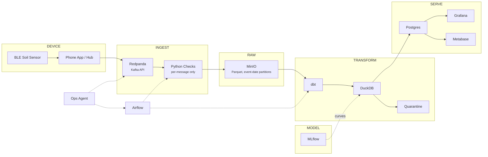
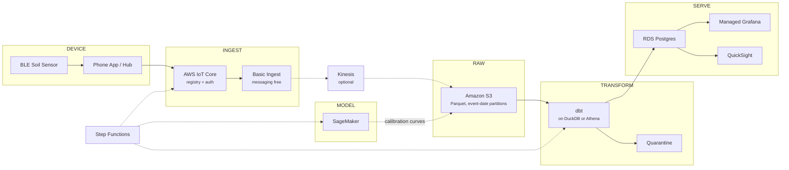

# Task 7 diagrams — Mermaid source

Exact text by construction. No image model, so no `Grafanna`.

**To export a PNG:** paste a block into <https://mermaid.live> → *Actions* →
*PNG* → save to `submission/out/figures/`. (Or GitHub renders these natively in
a `.md` file, which is the better home if you would rather not carry images.)

Both use the same left-to-right lane structure as the generated versions, so they
are drop-in replacements.

---

## Variant A — self-hosted / OSS

---

## Variant B — AWS managed

---

## Why these are worth having either way

- **The labels are exact.** No model deciding that `Redpanda` belongs in the
  DEVICE lane.
- **They diff.** A Mermaid block in a git repo shows a reviewable change when the
  architecture changes; a PNG does not.
- **The trade-off:** a Mermaid-rendered PNG is plainer than the generated
  diagram. For a design sketch that is fine — it is a diagram, not a graphic.

If you would rather keep the Gemini version, use the good one you already have
and apply the two-label edit above. Either works; do not spend more generations
on it.
